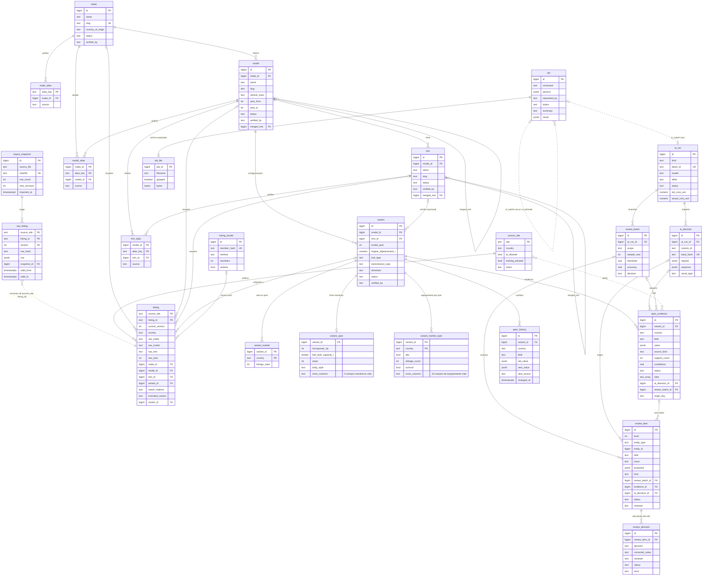

# Diccionario de datos: base de conocimiento de vehículos

Base PostgreSQL (versión 15 o superior) creada por las migraciones Alembic
[`0001_kb_schema`](../migrations/versions/0001_kb_schema.py) y
[`0002_review_web`](../migrations/versions/0002_review_web.py) (bandeja de decisiones del sitio de
revisión `src/web`), [`0003_web_jobs`](../migrations/versions/0003_web_jobs.py) (tareas que el sitio
encola), [`0004_queue_ai_origin`](../migrations/versions/0004_queue_ai_origin.py) (origen IA en la
cola) y [`0005_ai_run_cost`](../migrations/versions/0005_ai_run_cost.py) (costo real de cada corrida de
IA). La alimentan los anuncios de `data/vehicles.sqlite`, que se abre siempre en
solo lectura.

| Esquema | Para qué |
|---|---|
| `staging` | Copia cruda de cada importación, con historial por anuncio. Nunca se edita a mano. |
| `kb` | La base de conocimiento: identidad (marca → modelo → versión → variante), fichas técnicas, procedencia de cada valor, revisión humana y uso de IA. |
| `public` | Solo la tabla de control de Alembic `kb_alembic_version`. |

Índice:
1. [Diagrama entidad-relación](#1-diagrama-entidad-relación)
2. [Convenciones y valores comunes](#2-convenciones-y-valores-comunes)
3. [Esquema `staging`](#3-esquema-staging)
4. [Identidad: marca, modelo, versión](#4-identidad-marca-modelo-versión)
5. [Variantes y fichas técnicas](#5-variantes-y-fichas-técnicas)
6. [Anuncios](#6-anuncios)
7. [Procedencia e historial](#7-procedencia-e-historial)
8. [Revisión humana](#8-revisión-humana)
9. [IA (Claude, Message Batches)](#9-ia-claude-message-batches)
10. [Vistas](#10-vistas)
11. [Catálogos de valores](#11-catálogos-de-valores)

---

## 1. Diagrama entidad-relación

Las líneas continuas son llaves foráneas reales en la base. Las punteadas son relaciones
lógicas que valida el código, no la base:
- `review_item.entity_id` apunta a distintas tablas según `entity_type` (para un anuncio es
  `kb.listing_number(source_site, listing_id)`).
- `spec_evidence.sites` es un arreglo de nombres de `source_site`.

Para que el diagrama se lea mejor, las fichas `variant_spec` y `variant_market_spec` muestran
solo algunas columnas; la lista completa está en la [sección 5](#5-variantes-y-fichas-técnicas).

---

## 2. Convenciones y valores comunes

- Todas las fechas son `timestamptz` (UTC).
- Los `id` son `bigserial`.
- Los textos que vienen de los anuncios se guardan tal cual en columnas `raw_*`.
- Los nombres canónicos viven en `name`.
- Una entidad **nunca se borra** al fusionarse: queda como lápida, con `merged_into` y
  `status = 'rejected'`, para que sus grafías viejas sigan resolviendo hacia la entidad que quedó.

**`status` de `make`, `model` y `trim`**

| Valor | Significado |
|---|---|
| `accepted` | Identidad validada. Sus anuncios entran al consenso. |
| `unresolved` | Las reglas no la pudieron confirmar. Espera a la IA o a una persona. |
| `pending_review` | Hay un caso de revisión abierto que la bloquea. |
| `rejected` | No es válida (no existe, no es un vehículo) o se fusionó con otra. |

**`verified_by`: quién la validó**

| Valor | Significado |
|---|---|
| `seed` | Está en la lista curada `config/kb/makes.yaml`. |
| `multi_source` | Se vio en 5 o más anuncios o en 2 o más portales (versiones: 2 o más anuncios). |
| `ai` | La aceptó la IA, validada por muestreo. |
| `human` | La aceptó una persona, caso por caso. |
| `unverified` | Todavía sin validar. |

**`source` de las tablas `*_alias`**: `seed`, `rule`, `ai` o `manual`.

**Clave de alias (`alias_key`)**: el texto en minúsculas, sin acentos, espacios ni signos.
"Rav 4", "RAV4" y "rav-4" dan la misma clave, `rav4`.

---

## 3. Esquema `staging`

### `staging.import_snapshot`
Una fila por archivo importado. Si el archivo ya se importó (mismo sha256), no se crea otra.

| Columna | Tipo | Nulo | Default | Descripción |
|---|---|---|---|---|
| `id` | bigint | no | serial | PK. |
| `source_file` | text | no | | Ruta del SQLite importado. |
| `sha256` | text | no | | Huella del archivo. **UNIQUE**: impide importar dos veces lo mismo. |
| `row_count` | integer | no | | Filas leídas. |
| `new_versions` | integer | no | 0 | Versiones nuevas que generó esta carga (anuncios nuevos o cambiados). |
| `imported_at` | timestamptz | no | now() | Momento de la carga. |

### `staging.raw_listing`
Historial de cada anuncio. Solo se agrega una versión nueva cuando su contenido cambia.

| Columna | Tipo | Nulo | Default | Descripción |
|---|---|---|---|---|
| `source_site` | text | no | | PK. Portal de origen (`carroya`, `cars24`, `cofino`…). |
| `listing_id` | text | no | | PK. Id del anuncio en ese portal. |
| `version` | integer | no | | PK. 1, 2, 3… |
| `row_hash` | text | no | | sha256 del contenido, sin `scraped_at` ni `parse_warnings`. Detecta cambios. |
| `row` | jsonb | no | | La fila completa del scraper, con el esquema de `VehicleRecord`. |
| `snapshot_id` | bigint | no | | FK → `import_snapshot.id`. Carga que trajo esta versión. |
| `valid_from` | timestamptz | no | now() | Desde cuándo es la versión vigente. |
| `valid_to` | timestamptz | sí | | Hasta cuándo. `NULL` = versión vigente. |

Índice único parcial `raw_listing_current`: una sola versión vigente por anuncio.

---

## 4. Identidad: marca, modelo, versión

### `kb.source_site`
Portales de origen y sus permisos de uso.

| Columna | Tipo | Nulo | Default | Descripción |
|---|---|---|---|---|
| `site` | text | no | | PK. Nombre del portal en el scraper. |
| `country` | text | no | | País ISO del portal (`CO`, `IN`, `GT`…). Es el país del equipamiento. |
| `ai_allowed` | boolean | no | | Si su texto se puede enviar a la IA. **Cofino = false.** |
| `training_allowed` | boolean | no | | Si sus datos se pueden usar para entrenar modelos. **Cofino = false** (robots.txt `ai-train=no`). |
| `notes` | text | sí | | Motivo (por ejemplo, las señales del robots.txt). |

Valores iniciales: `carroya` (CO), `cars24` (IN), `cofino` (GT, sin IA ni entrenamiento),
`tucarro` (CO), `chileautos` (CL), `truecar` (US). Un portal desconocido que aparezca al
importar se registra solo, **con IA y entrenamiento desactivados**.

### `kb.make`: marca

| Columna | Tipo | Nulo | Default | Descripción |
|---|---|---|---|---|
| `id` | bigint | no | serial | PK. |
| `name` | text | no | | Nombre canónico ("Mercedes-Benz", "Citroën"). |
| `slug` | text | no | | Identificador URL. **UNIQUE**. |
| `country_of_origin` | text | sí | | País de la marca (de la lista semilla). |
| `status` | text | no | `unresolved` | Ver [convenciones](#2-convenciones-y-valores-comunes). |
| `verified_by` | text | no | `unverified` | Ver convenciones. |
| `created_at`, `updated_at` | timestamptz | no | now() | Auditoría. |

### `kb.make_alias`
Grafías de una marca. Una grafía nueva agrega una fila aquí, nunca una marca nueva.

| Columna | Tipo | Nulo | Descripción |
|---|---|---|---|
| `alias_key` | text | no | PK. Clave compacta ("mercedesbenz", "landrover"). |
| `make_id` | bigint | no | FK → `make.id` (ON DELETE CASCADE). |
| `source` | text | no | `seed` / `rule` / `ai` / `manual`. |

### `kb.model`: modelo

| Columna | Tipo | Nulo | Default | Descripción |
|---|---|---|---|---|
| `id` | bigint | no | serial | PK. |
| `make_id` | bigint | no | | FK → `make.id`. |
| `name` | text | no | | Nombre canónico ("Land Cruiser Prado", "RAV4"). |
| `slug` | text | no | | UNIQUE junto con `make_id`. |
| `vehicle_class` | text | sí | | `car`, `motorcycle` o `heavy`. |
| `year_from`, `year_to` | integer | sí | | Periodo de producción (propuesto por la IA y revisado). Los años de anuncios fuera de este rango van a revisión. |
| `status` | text | no | `unresolved` | Solo los modelos `accepted` pasan a consolidación (la espera es por entidad). |
| `verified_by` | text | no | `unverified` | |
| `merged_into` | bigint | sí | | FK → `model.id`. Si se fusionó, apunta al modelo que quedó. |
| `created_at`, `updated_at` | timestamptz | no | now() | |

### `kb.model_alias`

| Columna | Tipo | Nulo | Descripción |
|---|---|---|---|
| `make_id` | bigint | no | PK (1/2). FK → `make.id`. La grafía vale solo dentro de esa marca. |
| `alias_key` | text | no | PK (2/2). Clave compacta, sin atributos ("RAV4 HYBRID 4X4" → `rav4`). |
| `model_id` | bigint | no | FK → `model.id`. |
| `source` | text | no | `seed` / `rule` / `ai` / `manual`. |

### `kb.trim`: versión
Etiqueta comercial de la versión ("SRV", "LTZ", "Grand Touring"), sin atributos técnicos.

| Columna | Tipo | Nulo | Default | Descripción |
|---|---|---|---|---|
| `id` | bigint | no | serial | PK. |
| `model_id` | bigint | no | | FK → `model.id`. |
| `name` | text | no | | Nombre a mostrar. |
| `slug` | text | no | | Clave compacta; UNIQUE con `model_id`. |
| `status` | text | no | `unresolved` | Una versión `unresolved` **no** bloquea su modelo; solo bloquean `pending_review` y `rejected`. |
| `verified_by` | text | no | `unverified` | `multi_source` si se vio en 2 o más anuncios. |
| `merged_into` | bigint | sí | | FK → `trim.id`. |

### `kb.trim_alias`

| Columna | Tipo | Nulo | Descripción |
|---|---|---|---|
| `model_id` | bigint | no | PK (1/2). FK → `model.id`. |
| `alias_key` | text | no | PK (2/2). Clave compacta de la etiqueta. |
| `trim_id` | bigint | no | FK → `trim.id`. |
| `source` | text | no | `rule` / `ai` / `manual`. |

---

## 5. Variantes y fichas técnicas

### `kb.variant`: configuración concreta
La unidad que recibe la ficha: modelo + versión + año + motor + combustible + transmisión + tracción.

| Columna | Tipo | Nulo | Default | Descripción |
|---|---|---|---|---|
| `id` | bigint | no | serial | PK. |
| `model_id` | bigint | no | | FK → `model.id`. |
| `trim_id` | bigint | sí | | FK → `trim.id`. `NULL` = versión desconocida (Cars24 y Cofino no la publican). |
| `model_year` | integer | no | | Año modelo, entre 1900 y 2100. |
| `engine_displacement_l` | numeric(6,3) | sí | | Cilindrada en litros (motos con 3 decimales). CHECK 0.04–20. |
| `fuel_type` | text | sí | | Enum de combustible ([sección 11](#11-catálogos-de-valores)). |
| `transmission_type` | text | sí | | Enum de transmisión. |
| `drivetrain` | text | sí | | Enum de tracción (`2WD` = 4x2 sin saber si es delantera o trasera). |
| `status` | text | no | `accepted` | `pending_review` si una validación cruzada la marcó (por ejemplo, moto G 310 con 1.0 L); `rejected` si una persona dijo que la clave está mal. Sus fichas no se publican mientras no esté `accepted`. |
| `verified_by` | text | no | `unverified` | |
| `created_at` | timestamptz | no | now() | |

**UNIQUE NULLS NOT DISTINCT** (`model_id`, `trim_id`, `model_year`, `engine_displacement_l`,
`fuel_type`, `transmission_type`, `drivetrain`): dos valores nulos cuentan como iguales, así que
nunca se duplica una variante.

### `kb.variant_market`: dónde se vio cada variante

| Columna | Tipo | Nulo | Default | Descripción |
|---|---|---|---|---|
| `variant_id` | bigint | no | | PK (1/2). FK → `variant.id`. |
| `country` | text | no | | PK (2/2). País ISO. |
| `listings_seen` | integer | no | 0 | Anuncios de esa variante en ese país. |

### `kb.variant_spec`: ficha mecánica (una por variante, compartida entre países)
Contiene solo valores **aceptados** (`accepted` o `accepted_sampled`) de `spec_evidence`.

| Columna | Tipo | Unidad / rango (CHECK) | Descripción |
|---|---|---|---|
| `variant_id` | bigint | | PK. FK → `variant.id`. |
| `engine_cylinders` | integer | 1–16 | Número de cilindros. |
| `horsepower_hp` | integer | hp, 1–2000 | Potencia. |
| `fuel_tank_capacity_l` | double | L, 1–1500 | Capacidad del tanque. |
| `seats` | integer | 1–80 | Puestos (incluye buses). |
| `doors` | integer | 0–6 | Puertas. |
| `cargo_capacity_l` | integer | L, 10–100000 | Maletero o capacidad de carga. |
| `wheel_size_in` | integer | pulgadas, 8–30 | Rin. |
| `tire_size` | text | | Medida de llanta ("235/60R16"). |
| `fuel_economy_kml` | double | km/L, 1–100 | Rendimiento. |
| `ev_range_km` | integer | km, 10–1500 | Autonomía eléctrica. |
| `ev_charging_speed_kw` | double | kW, 1–1000 | Potencia de carga. |
| `body_style` | text | enum de carrocería | Carrocería. |
| `country_of_manufacture` | text | | País de fabricación. |
| `updated_at` | timestamptz | | Última publicación. |

### `kb.variant_market_spec`: equipamiento (uno por variante y país)
El equipamiento es por país porque la misma versión puede venir distinta en Colombia y en India.

| Columna | Tipo | Descripción |
|---|---|---|
| `variant_id` | bigint | PK (1/2). FK → `variant.id`. |
| `country` | text | PK (2/2). País ISO. |
| `airbags_count` | integer | Número de airbags (CHECK 0–14). |
| `screen_size_in` | double | Pantalla en pulgadas (CHECK 2–25). |
| Booleanos de seguridad | boolean | `abs`, `stability_control`, `traction_control`. |
| Booleanos ADAS | boolean | `adaptive_cruise_control`, `lane_assist`, `automatic_emergency_braking`, `blind_spot_monitoring`. |
| Booleanos de exterior | boolean | `led_lights`, `fog_lights`, `sunroof`, `panoramic_roof`, `roof_rails`, `alloy_wheels`. |
| Booleanos de interior | boolean | `leather_seats`, `power_seats`, `heated_seats`, `cooled_seats`, `memory_seats`. |
| Booleanos de confort | boolean | `climate_control`, `dual_zone_ac`, `keyless_entry`, `push_button_start`. |
| Booleanos de infoentretenimiento | boolean | `bluetooth`, `apple_carplay`, `android_auto`, `navigation`. |
| Booleanos de cámaras y parqueo | boolean | `reverse_camera`, `camera_360`, `front_camera`, `parking_sensors`, `automatic_parking`. |
| Booleanos de seguridad antirrobo | boolean | `alarm`, `immobilizer`. |
| Booleanos de utilidad | boolean | `tow_package`, `bed_liner`. |
| `updated_at` | timestamptz | Última publicación. |

En el equipamiento, `true` quiere decir "de serie en esa versión y país", `false` quiere decir
"no lo trae" (solo cuando la fuente lo dice explícitamente) y `NULL` quiere decir "no se sabe".

---

## 6. Anuncios

### `kb.listing`: anuncio y su identidad resuelta

| Columna | Tipo | Nulo | Default | Descripción |
|---|---|---|---|---|
| `source_site` | text | no | | PK (1/2). FK → `source_site.site`. |
| `listing_id` | text | no | | PK (2/2). |
| `current_version` | integer | no | | Versión vigente en `staging.raw_listing`. |
| `first_seen`, `last_seen` | timestamptz | no | now() | Primera y última carga donde apareció. |
| `country` | text | no | | País del portal. |
| `listed_at` | timestamptz | sí | | Fecha de publicación según el portal. |
| `raw_make`, `raw_model`, `raw_trim` | text | sí | | Texto original del vendedor. |
| `raw_year` | integer | sí | | Año que publicó el vendedor. |
| `make_id`, `model_id`, `trim_id` | bigint | sí | | FK a la identidad resuelta. |
| `variant_id` | bigint | sí | | FK → `variant.id` (ON DELETE SET NULL). `NULL` mientras su modelo espera por identidad. |
| `match_method` | text | sí | | `rule`, `rule_partial` (le faltaba algún atributo y se unió a la única variante compatible), `ai` o `manual`. |
| `match_confidence` | real | sí | | Reservado para coincidencias no exactas. |
| `excluded_reason` | text | sí | | Por qué no participa: `no_make`, `no_model`, `no_year`, `year_out_of_range`, `year_review`. |
| `cluster_id` | bigint | sí | | FK → `listing_cluster.id`. Mismo carro en otro anuncio. |

Si un anuncio cambia de contenido, se limpia su identidad para que `kb normalize` la resuelva otra vez.

### `kb.listing_cluster`: mismo carro en varios portales o republicado
Heurística: mismo modelo y año, kilometraje ±2 %, precio ±5 % en la misma moneda y fechas
a menos de 30 días. Los anuncios del grupo cuentan como **un solo voto** en el consenso.

| Columna | Tipo | Nulo | Default | Descripción |
|---|---|---|---|---|
| `id` | bigint | no | serial | PK. |
| `member_hash` | text | no | | Huella de los miembros. UNIQUE. |
| `method` | text | no | | `heuristic` o `manual`. |
| `members` | integer | no | | Cantidad de anuncios. |
| `undone` | boolean | no | false | Una persona deshizo el grupo: no se vuelve a aplicar. |
| `created_at` | timestamptz | no | now() | |

---

## 7. Procedencia e historial

### `kb.spec_evidence`: de dónde sale cada valor
Una fila por fuente, campo y variante (y país, si es equipamiento). El valor publicado de cada
campo es la mejor evidencia aceptada, según la precedencia de `source_kind`.

| Columna | Tipo | Nulo | Default | Descripción |
|---|---|---|---|---|
| `id` | bigint | no | serial | PK. |
| `variant_id` | bigint | no | | FK → `variant.id`. |
| `country` | text | no | `''` | `''` en campos mecánicos; país ISO en equipamiento. |
| `field` | text | no | | Nombre del campo (columna de `variant_spec` o `variant_market_spec`). |
| `value` | jsonb | no | | Valor ya normalizado (número, texto o booleano). |
| `source_kind` | text | no | | Origen; ver la tabla de precedencia abajo. |
| `support_count` | integer | no | 0 | Anuncios distintos que respaldan el valor (un cluster cuenta 1). |
| `agreement` | real | sí | | Fracción de anuncios que coinciden (0–1). |
| `confidence` | real | sí | | Confianza 0–1. |
| `status` | text | no | | `accepted`, `accepted_sampled` (aceptado por muestreo), `pending_review` o `rejected`. |
| `sites` | text[] | no | `{}` | Portales que aportan el valor. Sirve para excluir lo que no se puede usar para entrenamiento. |
| `reason` | text | sí | | Motivo del estado (`listings_disagree`, `outlier_in_model`, `neighbouring_years`…). |
| `review_batch_id` | bigint | sí | | FK → `review_batch.id`. Lote de muestreo al que pertenece. |
| `ai_decision_id` | bigint | sí | | FK → `ai_decision.id`. Respuesta de la IA que lo propuso. |
| `origin_key` | text | no | `''` | Distingue varias evidencias del mismo tipo (`ai:<id>`, `review:<id>`). |
| `created_at`, `updated_at` | timestamptz | no | now() | |

UNIQUE (`variant_id`, `country`, `field`, `source_kind`, `origin_key`): repetir un paso
actualiza la fila, no la duplica.

**Precedencia de `source_kind`** (de mayor a menor):

| Rango | `source_kind` | Origen | Estado inicial |
|---|---|---|---|
| 5 | `manual` | Lo decidió una persona en revisión. Nunca se reemplaza solo. | `accepted` |
| 4 | `listing_consensus` | 2 o más anuncios coinciden (≥ 70 %). | `accepted`, o `pending_review` si se contradicen |
| 3 | `listing_single` | Un solo anuncio. Solo en campos mecánicos; confianza 0.6. | `accepted` si es plausible |
| 2 | `sibling_inference` | Misma versión y motor en años vecinos (±2): puertas, puestos, tanque, maletero. | `accepted` (confianza 0.5) |
| 1 | `ai_knowledge` | Propuesto por Claude. | Siempre `pending_review` |

### `kb.spec_history`: cambios de valores publicados

| Columna | Tipo | Nulo | Default | Descripción |
|---|---|---|---|---|
| `id` | bigint | no | serial | PK. |
| `variant_id` | bigint | no | | FK → `variant.id`. |
| `country` | text | no | `''` | Como en `spec_evidence`. |
| `field` | text | no | | Campo que cambió. |
| `old_value`, `new_value` | jsonb | sí | | Antes y después (`NULL` = vacío). |
| `old_source`, `new_source` | text | sí | | `source_kind` anterior y nuevo. |
| `reason` | text | sí | | Paso que lo cambió (`consolidate`). |
| `changed_at` | timestamptz | no | now() | |

---

## 8. Revisión humana

### `kb.review_item`: caso de revisión
Un caso por pregunta. Un índice único parcial impide abrir dos veces el mismo caso pendiente,
y una pregunta ya decidida no se vuelve a hacer.

| Columna | Tipo | Nulo | Default | Descripción |
|---|---|---|---|---|
| `id` | bigint | no | serial | PK. |
| `level` | integer | no | | Orden de resolución: 1 marca, 2 modelo, 3 año, 4 variante, 5 ficha mecánica, 6 equipamiento. |
| `entity_type` | text | no | | `make`, `model`, `trim`, `listing`, `variant` o `spec`. |
| `entity_id` | bigint | no | | Id en la tabla que indica `entity_type`. En `listing` es un hash numérico de (sitio, id); en `spec` es el `variant_id`. Relación lógica, no FK. |
| `country` | text | no | `''` | País (equipamiento). |
| `field` | text | no | `''` | Campo afectado, si aplica. |
| `issue` | text | no | | Tipo de caso ([sección 11](#11-catálogos-de-valores)). |
| `proposed` | jsonb | sí | | Propuesta (de la IA o de una regla). |
| `current` | jsonb | sí | | Valor actual o detalle de la validación. |
| `evidence` | jsonb | sí | | Contexto: grafías, sitios, años, anuncios. |
| `source` | text | no | | `rule`, `ai` o `merge`. Un caso que la IA respondió sigue en `ai` aunque `normalize` lo vuelva a abrir. |
| `kind` | text | no | | `individual` (caso por caso) o `sample` (parte de un lote por muestreo). |
| `review_batch_id` | bigint | sí | | FK → `review_batch.id`. |
| `evidence_id` | bigint | sí | | FK → `spec_evidence.id`. |
| `ai_decision_id` | bigint | sí | | FK → `ai_decision.id`. Respuesta de la IA cuya propuesta está en `proposed`. |
| `listings_affected` | integer | no | 0 | Anuncios que desbloquea. La cola se ordena por nivel y luego por este número. |
| `status` | text | no | `pending` | `pending`, `approved`, `rejected` o `corrected`. |
| `corrected_value` | jsonb | sí | | Valor correcto, cuando `status = corrected`. |
| `reviewer` | text | sí | | Quién decidió (`sample:<lote>` si se aceptó por muestreo). |
| `decided_at` | timestamptz | sí | | |
| `note` | text | sí | | Nota libre; `IN SAMPLE` marca los casos que caen en la muestra. |
| `created_at` | timestamptz | no | now() | |

### `kb.review_batch`: lote de muestreo
Si la muestra tiene `threshold` o más de aciertos, los valores del lote con confianza
≥ `min_confidence` pasan a `accepted_sampled`. Si no, el lote entero se rechaza.

| Columna | Tipo | Nulo | Default | Descripción |
|---|---|---|---|---|
| `id` | bigint | no | serial | PK. |
| `ai_run_id` | bigint | sí | | FK → `ai_run.id`. |
| `scope` | text | no | | `identity` o `specs`. |
| `seed` | integer | no | | Semilla del muestreo (reproducible). |
| `sample_size` | integer | no | | Tamaño de la muestra (50 por defecto, estratificada por campo). |
| `threshold` | real | no | | Precisión mínima (0.95). |
| `min_confidence` | real | no | | Confianza mínima para aceptar por lote (0.8). |
| `correct` | integer | sí | | Casos correctos en la muestra. |
| `accuracy` | real | sí | | `correct / muestra`. |
| `decision` | text | sí | | `accepted` o `rejected`. |
| `decided_by`, `decided_at` | text, timestamptz | sí | | |
| `created_at` | timestamptz | no | now() | |

### `kb.review_decision`: bandeja del sitio de revisión
Cada decisión tomada en el sitio web (`src/web`). El sitio solo inserta aquí; el worker de Python
(`vehicle-scraper kb review worker`) la aplica con el mismo código que `kb review import`
(`review.decide_item`). También es la auditoría de quién decidió qué. Migración `0002_review_web`.

| Columna | Tipo | Nulo | Default | Descripción |
|---|---|---|---|---|
| `id` | bigint | no | serial | PK. |
| `review_item_id` | bigint | no | | FK → `review_item.id` (`ON DELETE CASCADE`). |
| `decision` | text | no | | `approved`, `rejected` o `corrected`. |
| `corrected_value` | text | sí | | Valor correcto (máx. 500). Obligatorio si `decision = corrected`. Para fusionar un modelo: `merge:<nombre>`. |
| `note` | text | sí | | Nota del revisor (máx. 2000). |
| `reviewer` | text | no | | Quién decidió (1 a 100 caracteres). |
| `status` | text | no | 'queued' | `queued` (esperando al worker), `applied`, `failed` (ver `error`) o `superseded` (el caso ya estaba decidido). |
| `error` | text | sí | | Por qué no se aplicó. |
| `submitted_at` | timestamptz | no | now() | Cuándo se envió. |
| `processed_at` | timestamptz | sí | | Cuándo la procesó el worker. |

- Índice único parcial `review_decision_queued`: una sola decisión `queued` por caso (un doble
  clic o dos revisores no la encolan dos veces).
- Trigger `review_decision_notify` (`AFTER INSERT`): `pg_notify('kb_review_decision', id)` despierta
  al worker, que aplica la decisión en menos de un segundo.
- El rol del sitio (`docs/sql/review_web_role.sql`) solo puede insertar las columnas
  `review_item_id`, `decision`, `corrected_value`, `note` y `reviewer`; `status` y `error` los
  escribe el worker.

### `kb.job`: tareas que encola el sitio
Comandos `kb` pedidos desde `/tareas`. El sitio solo inserta `command`, `params` y `requested_by`; el
worker (`vehicle-scraper kb worker`) los ejecuta uno a uno con `kb/commands.py`, el mismo código del
CLI. Migración `0003_web_jobs`.

| Columna | Tipo | Nulo | Default | Descripción |
|---|---|---|---|---|
| `id` | bigint | no | serial | PK. |
| `command` | text | no | | `normalize`, `consolidate`, `recalculate`, `export`, `ai_estimate`, `ai_collect` o `ai_submit`. |
| `params` | jsonb | no | '{}' | Parámetros (objeto). El sitio y el worker los validan contra una lista cerrada. |
| `requested_by` | text | no | | Quién la pidió (1 a 100 caracteres). |
| `status` | text | no | 'queued' | `queued`, `running`, `done`, `failed` o `canceled`. |
| `summary` | text | sí | | Resumen legible (lo mismo que imprime el CLI). |
| `result` | jsonb | sí | | Resultado estructurado. En `ai_estimate`: parámetros, estimado y `fingerprint` de los requests. |
| `error` | text | sí | | Por qué falló. Si falla, ningún cambio de la tarea queda guardado. |
| `created_at` | timestamptz | no | now() | Cuándo se pidió. |
| `started_at`, `finished_at` | timestamptz | sí | | Cuándo empezó y terminó. |

- Índice único parcial `job_active`: la misma tarea (`command` + `params`) no puede estar dos veces
  en cola o corriendo.
- Trigger `job_notify` (`AFTER INSERT`): `pg_notify('kb_job', id)` despierta al worker.
- Función `kb.cancel_job(id)` (`SECURITY DEFINER`): pasa una tarea `queued` a `canceled`. Es lo único
  que el rol del sitio puede modificar.
- `ai_submit` (cuesta dinero) solo se ejecuta si el worker tiene `KB_ALLOW_WEB_AI_SUBMIT=true`, apunta a
  un `ai_estimate` terminado hace menos de 60 minutos, los requests siguen siendo los mismos
  (`fingerprint`) y `confirm_usd` cubre el costo estimado.

### `kb.job_file`: archivos de las tareas
| Columna | Tipo | Nulo | Default | Descripción |
|---|---|---|---|---|
| `job_id` | bigint | no | | PK, FK → `job.id` (`ON DELETE CASCADE`). |
| `filename` | text | no | | Nombre de descarga (`kb_listings.csv`, `kb_listings_sources.xlsx`…). |
| `content_type` | text | no | | Tipo MIME. |
| `gzipped` | boolean | no | | `true` para CSV y JSON (se guardan comprimidos); el XLSX ya viene comprimido. |
| `size` | bigint | no | | Tamaño sin comprimir, en bytes. |
| `bytes` | bytea | no | | El archivo. Se conservan solo las últimas 10 exportaciones. |

---

## 9. IA (Claude, Message Batches)

### `kb.ai_run`: un batch enviado

| Columna | Tipo | Nulo | Default | Descripción |
|---|---|---|---|---|
| `id` | bigint | no | serial | PK. |
| `kind` | text | no | | `identity` (validar marca, modelo, versión y año) o `specs` (completar fichas). |
| `batch_id` | text | sí | | Id del batch en la API de Anthropic. UNIQUE. |
| `model` | text | no | | `claude-opus-5-5`. |
| `effort` | text | no | | `low` (identidad) o `medium` (fichas). |
| `status` | text | no | `prepared` | `prepared`, `submitted`, `ended`, `applied` o `canceled`. |
| `request_count` | integer | no | 0 | Requests del batch. |
| `submitted_at`, `ended_at` | timestamptz | sí | | |
| `input_tokens`, `output_tokens`, `cache_read_tokens`, `cache_write_tokens` | bigint | no | 0 | Consumo real reportado por la API (`cache_write_tokens`: migración `0005`). |
| `est_cost_usd` | numeric(10,4) | sí | | Costo estimado antes de enviar. |
| `actual_cost_usd` | numeric(10,4) | sí | | Costo real del lote, calculado con su consumo al recogerlo (`NULL` mientras no se recoge). Migración `0005`. |
| `created_at` | timestamptz | no | now() | |

### `kb.ai_decision`: un request y su respuesta

| Columna | Tipo | Nulo | Default | Descripción |
|---|---|---|---|---|
| `id` | bigint | no | serial | PK. |
| `ai_run_id` | bigint | no | | FK → `ai_run.id`. |
| `custom_id` | text | no | | Id del request dentro del batch; UNIQUE con `ai_run_id`. Los resultados se cruzan por aquí porque llegan en cualquier orden. |
| `input_hash` | text | no | | sha256 del request más la versión del prompt. **UNIQUE**: un request ya respondido no se reenvía ni se vuelve a pagar. |
| `request` | jsonb | no | | Parámetros enviados y metadatos para aplicar la respuesta. |
| `response` | jsonb | sí | | JSON devuelto (salida estructurada). |
| `result_type` | text | sí | | `succeeded`, `errored`, `canceled`, `expired` o `unparseable`. |
| `stop_reason` | text | sí | | `end_turn`, `max_tokens`, `refusal`… |
| `applied` | boolean | no | false | Si su contenido ya pasó a evidencia y a casos de revisión. |

---

## 10. Vistas

### `kb.listing_standardized`
Cada anuncio en el esquema estricto, completado con la base de conocimiento. Es lo que
exporta `kb export`.

- **Campos mecánicos:** se prefiere la ficha validada de la variante y, si no hay, el valor del anuncio.
- **Equipamiento:** se prefiere lo que reporta ese carro y, si no hay, el equipamiento de serie
  de su versión en ese país.
- Cada campo tiene una columna `<campo>__src` con el valor `kb`, `listing` o `NULL`.
- Columnas extra: `vehicle_class`, `vehicle_type` (`Motorcycle` si la clase es moto),
  `variant_status`, `model_status`, los `*_verified_by`, `match_method` y `cluster_id`.

### `kb.review_queue`
Cada `review_item` con una etiqueta legible y la marca y el modelo a los que pertenece. Es lo que
lista el sitio de revisión y lo que exporta `kb review export`.

- Todas las columnas de `review_item`, más:
  - `in_queue`: el caso entra a la cola (individual, o en la muestra de un lote);
  - `make_id`, `make_name`, `model_id`, `model_name`, `variant_id` y `vehicle_class`, según la entidad;
  - `entity_label`: "Marca", "Marca / Modelo", la variante completa (marca, modelo, versión, año,
    cilindrada, combustible, transmisión y tracción) o el anuncio (`portal:id` y lo que escribió el vendedor);
  - `queued_decision_id`: la decisión en cola para el caso, si la hay;
  - `from_ai`: la propuesta viene de un lote de Claude (`ai_decision_id` no nulo), y `ai_run_id`, la
    corrida de ese lote. Migración `0004_queue_ai_origin`.
- Orden de revisión: `level`, individuales antes que muestra, `listings_affected` descendente, `id`.

### `kb.training_safe_evidence`
`spec_evidence` sin ninguna fila que dependa de un portal con `training_allowed = false`. Es la
única fuente válida si algún día se entrena o ajusta un modelo con esta base.

### Función `kb.listing_number(site, listing_id)`
Número estable de un anuncio (`bigint`): los primeros 15 dígitos hexadecimales del sha256 de
`site|listing_id`. Es el `review_item.entity_id` de los casos sobre un anuncio y coincide con
`identity.listing_number()` en Python. Tiene índice sobre `kb.listing`.

---

## 11. Catálogos de valores

| Dominio | Valores |
|---|---|
| `fuel_type` | `Gasoline`, `Diesel`, `Hybrid`, `EV`, `CNG` |
| `transmission_type` | `Manual`, `Automatic`, `CVT`, `DCT` |
| `drivetrain` | `FWD`, `RWD`, `AWD`, `4WD`, `2WD` |
| `body_style` | `SUV`, `Sedan`, `Pickup`, `Hatchback`, `Coupe`, `Van`, `Convertible`, `Wagon`, `Truck`, `Minivan`, `Motorcycle` |
| `vehicle_class` | `car`, `motorcycle`, `heavy` |

**`review_item.issue`**

| Issue | Nivel | Qué pregunta |
|---|---|---|
| `unresolved_make` | 1 | ¿Es una marca real? ¿Es otra grafía o submarca de una conocida? |
| `unresolved_model` | 2 | ¿Es un modelo real de esta marca? ¿Se fusiona con otro? Nombre canónico, clase y años de producción. |
| `year_out_of_range` | 3 | Año imposible (antes de 1950 o después del año siguiente al actual). |
| `year_outside_production` | 3 | Año fuera del periodo de producción del modelo. |
| `name_vs_displacement` | 4 | En una moto, el número del nombre no coincide con los cc (G 310 con 1.0 L). |
| `title_vs_displacement` | 4 | El "1.8" de la versión no coincide con la cilindrada. |
| `ev_with_displacement` | 4 | Un eléctrico con cilindrada. |
| `listings_disagree` | 5 | Los anuncios de la variante no coinciden (menos del 70 % de acuerdo). |
| `outlier_in_model` | 5 | Valor atípico frente a variantes comparables (MAD y más de 25 % de la mediana). |
| `hp_per_litre` | 5 | Potencia por litro fuera de 15–260 hp/L. |
| `seats_vs_body` | 5 | Más de 9 puestos en un carro que no es van, minivan ni camión. |
| `doors_on_motorcycle` | 5 | Una moto con puertas. |
| `conflicts_with_human` | 5–6 | Evidencia nueva contradice un valor aprobado por una persona. |
| `merge_human_conflict` | 5 | Al fusionar dos variantes, los valores aprobados por personas no coinciden. |
| `ai_value` | 5–6 | Campo crítico propuesto por la IA sin consenso de anuncios (revisión individual). |
| `ai_value_sample` | 5–6 | Valor de la IA que cayó en la muestra del lote. |
| `ai_suspect_known` | 5 | La IA cree que un valor ya publicado está mal. |

**Campos críticos** (revisión individual cuando vienen de la IA): `engine_displacement_l`,
`horsepower_hp`, `fuel_type`, `transmission_type`, `drivetrain`, `body_style`, `seats`, `doors`.
